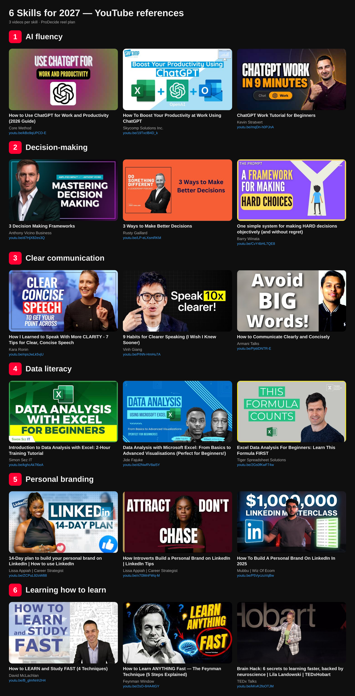
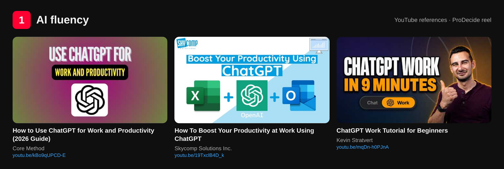
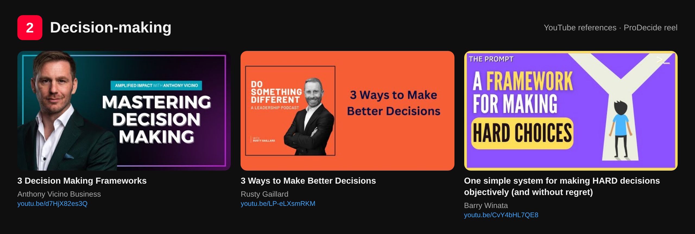
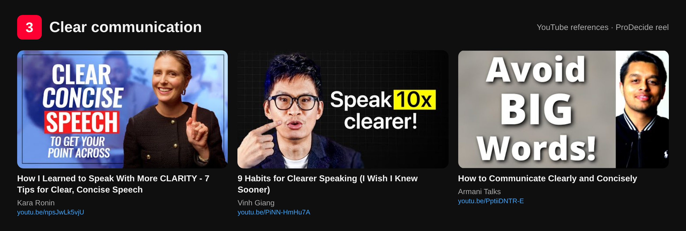
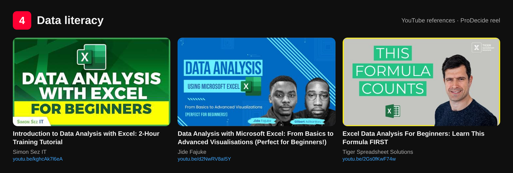
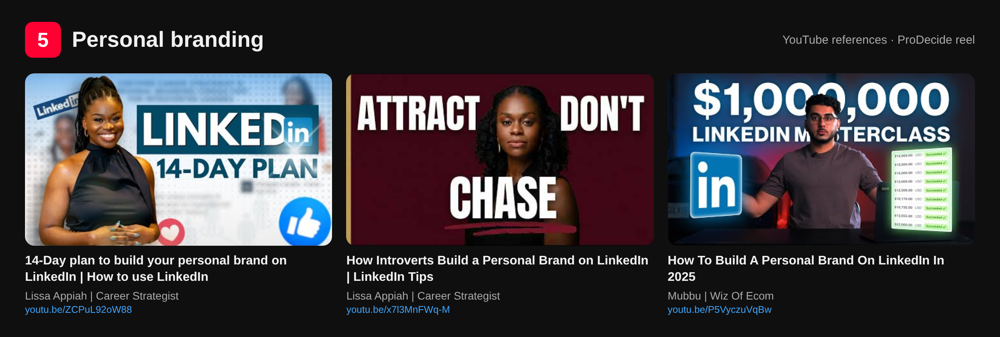
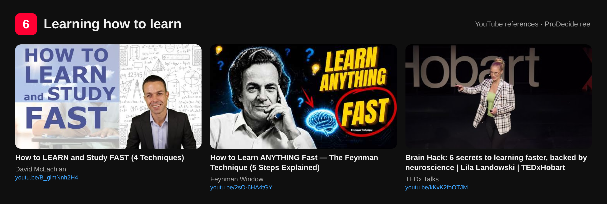

# Reel references: 6 skills for 2027

YouTube videos for each skill in the ProDecide reel plan, 3 per skill.

## 1. AI fluency

- [How to Use ChatGPT for Work and Productivity (2026 Guide)](https://www.youtube.com/watch?v=kBo9qUPCD-E): Core Method
- [How To Boost Your Productivity at Work Using ChatGPT](https://www.youtube.com/watch?v=19TxclB4D_k): Skycomp Solutions Inc.
- [ChatGPT Work Tutorial for Beginners](https://www.youtube.com/watch?v=mqDn-h0PJnA): Kevin Stratvert

## 2. Decision-making

- [3 Decision Making Frameworks](https://www.youtube.com/watch?v=d7HjX82es3Q): Anthony Vicino Business
- [3 Ways to Make Better Decisions](https://www.youtube.com/watch?v=LP-eLXsmRKM): Rusty Gaillard
- [One simple system for making HARD decisions objectively (and without regret)](https://www.youtube.com/watch?v=CvY4bHL7QE8): Barry Winata

## 3. Clear communication

- [How I Learned to Speak With More CLARITY - 7 Tips for Clear, Concise Speech](https://www.youtube.com/watch?v=npsJwLk5vjU): Kara Ronin
- [9 Habits for Clearer Speaking (I Wish I Knew Sooner)](https://www.youtube.com/watch?v=PiNN-HmHu7A): Vinh Giang
- [How to Communicate Clearly and Concisely](https://www.youtube.com/watch?v=PptiiDNTR-E): Armani Talks

## 4. Data literacy

- [Introduction to Data Analysis with Excel: 2-Hour Training Tutorial](https://www.youtube.com/watch?v=kghcAk7l6eA): Simon Sez IT
- [Data Analysis with Microsoft Excel: From Basics to Advanced Visualisations (Perfect for Beginners!)](https://www.youtube.com/watch?v=d2NwRV8aI5Y): Jide Fajuke
- [Excel Data Analysis For Beginners: Learn This Formula FIRST](https://www.youtube.com/watch?v=2Gs0fKwF74w): Tiger Spreadsheet Solutions

## 5. Personal branding

- [14-Day plan to build your personal brand on LinkedIn | How to use LinkedIn](https://www.youtube.com/watch?v=ZCPuL92oW88): Lissa Appiah | Career Strategist
- [How Introverts Build a Personal Brand on LinkedIn | LinkedIn Tips](https://www.youtube.com/watch?v=x7l3MnFWq-M): Lissa Appiah | Career Strategist
- [How To Build A Personal Brand On LinkedIn In 2025](https://www.youtube.com/watch?v=P5VyczuVqBw): Mubbu | Wiz Of Ecom

## 6. Learning how to learn

- [How to LEARN and Study FAST (4 Techniques)](https://www.youtube.com/watch?v=B_glmNnh2H4): David McLachlan
- [How to Learn ANYTHING Fast — The Feynman Technique (5 Steps Explained)](https://www.youtube.com/watch?v=2sO-6HA4tGY): Feynman Window 
- [Brain Hack: 6 secrets to learning faster, backed by neuroscience | Lila Landowski | TEDxHobart](https://www.youtube.com/watch?v=kKvK2foOTJM): TEDx Talks

_These are other creators' videos. Use them for inspiration and reference only._
